# ¿Qué hay en la foto?

Tomas una foto con el teléfono, la subes, y en un par de segundos la aplicación te dice qué ve en ella, con un porcentaje al lado de cada cosa. La foto queda guardada en un bucket de Cloud Storage y aparece en una galería con las últimas fotos del grupo. Quien reconoce lo que hay en la imagen no es código tuyo: es Cloud Vision, un modelo que Google ya entrenó y que se usa con una petición HTTP.

La plantilla trae las dos aplicaciones completas y la infraestructura del frontend y el backend. Tu grupo construye en Terraform el bucket, el permiso del backend sobre él y el acceso a Vision.

| Sin bucket todavía | Con etiquetas | La galería |
|---|---|---|
| 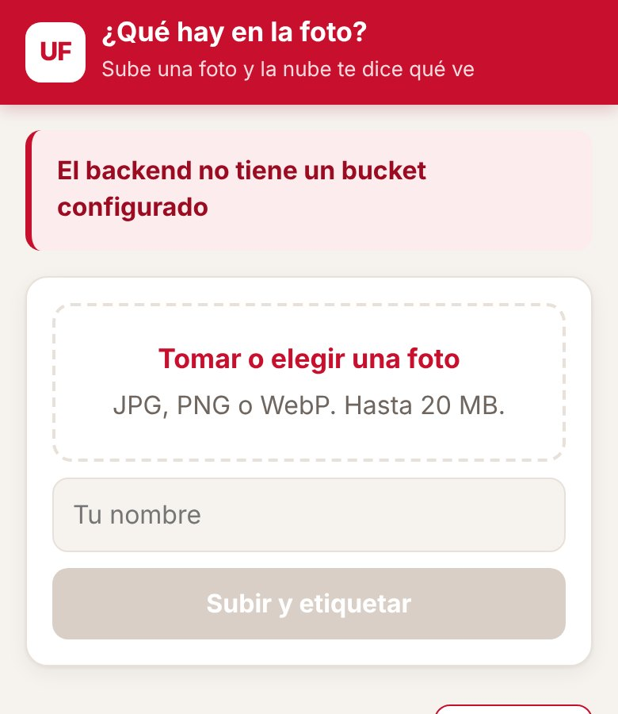 | 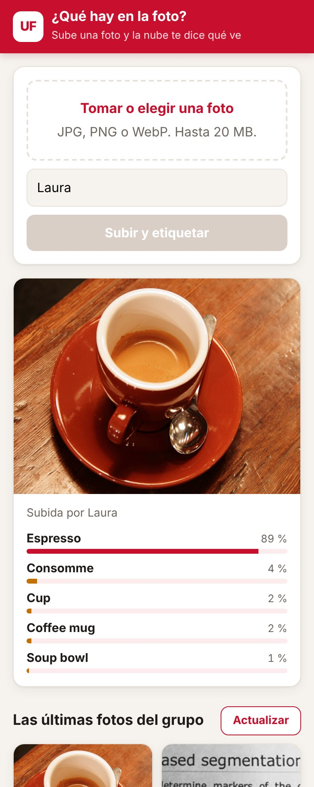 | 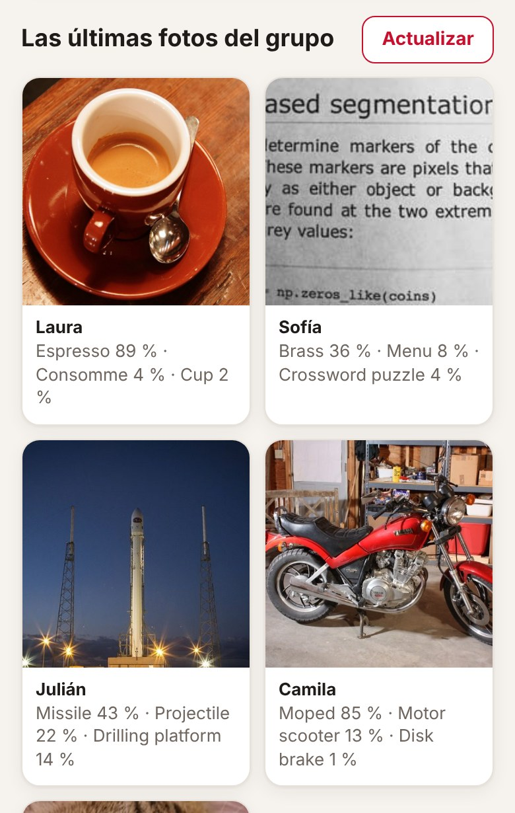 |

Las capturas salen de una prueba local: Cloud Storage simulado y, en lugar de Vision, un modelo de clasificación pequeño corriendo en el computador. Por eso las etiquetas de las capturas no son las de Vision; las reales las vas a ver cuando lo despliegues.

## Arquitectura al terminar la práctica

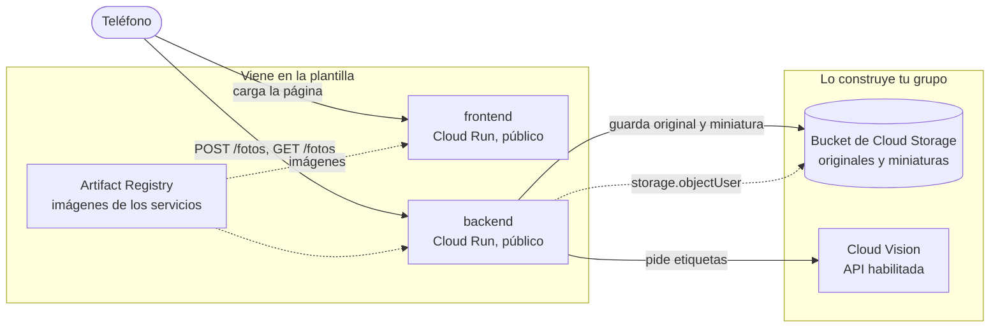

La flecha punteada es el único permiso de IAM que da tu grupo: la cuenta del backend puede crear, leer y listar objetos en ese bucket y en ningún otro. Para llamar a Vision no hace falta ningún rol: basta con que la API esté habilitada en el proyecto y con que el backend corra con una cuenta de servicio del mismo proyecto.

En la plantilla, la variable `BUCKET` del backend está vacía: responde que no tiene dónde guardar y no guarda nada. Es lo primero que vas a ver al desplegar.

## Estructura del repositorio

```
backend/main.py            API en Flask: recibe la foto, hace la miniatura, pide etiquetas y guarda en el bucket
backend/requirements.txt   Dependencias del backend con versión fija
backend/Dockerfile         Imagen del backend con gunicorn
frontend/index.html        La página: subir una foto, ver sus etiquetas y la galería del grupo
frontend/server.py         Servidor sin dependencias que inyecta BACKEND_URL en la página
frontend/Dockerfile        Imagen del frontend
infra/providers.tf         Versión de Terraform y del proveedor de Google
infra/variables.tf         Proyecto, prefijo, región e imágenes
infra/main.tf              APIs, registro, backend y frontend con sus cuentas
infra/outputs.tf           Ruta del registro y URL de los servicios
infra/terraform.tfvars.example   Ejemplo de valores; cópialo como terraform.tfvars
docs/api.md                Endpoints del backend y cómo se guardan las fotos
docs/capturas/             Capturas de la aplicación usadas en este README
.gitignore                 Deja por fuera el estado de Terraform, tus tfvars y __pycache__
```

## Cómo empezar

### Flujo de trabajo

1. Crea el repositorio de tu grupo con **Use this template** en GitHub.
2. Edita en VS Code o en github.dev (tecla `.` en la página del repositorio).
3. Haz commit y push desde el editor.
4. En Cloud Shell clonas la primera vez y traes los cambios con `git pull` después. Desde Cloud Shell nunca haces push.
5. Docker y Terraform se ejecutan siempre en Cloud Shell. La consola de Google Cloud es para mirar y diagnosticar, no para crear recursos.

### Primer despliegue

En Cloud Shell:

```bash
git clone https://github.com/<tu-usuario>/<tu-repositorio>.git
cd <tu-repositorio>/infra
cp terraform.tfvars.example terraform.tfvars
cloudshell edit terraform.tfvars
```

En `terraform.tfvars` pon el ID de tu proyecto y el prefijo del grupo, y ajusta las rutas de las imágenes a esos mismos valores. Este archivo vive solo en Cloud Shell: el `.gitignore` evita que llegue a GitHub.

El orden importa, porque las imágenes necesitan el registro y los servicios necesitan las imágenes:

```bash
# 1. Solo el registro (y las APIs de las que depende)
terraform init
terraform apply -target=google_artifact_registry_repository.registro

# 2. Las imágenes
REGISTRO=$(terraform output -raw registro)
gcloud auth configure-docker us-central1-docker.pkg.dev --quiet
cd ..
docker build -t $REGISTRO/backend:v1 backend
docker push $REGISTRO/backend:v1
docker build -t $REGISTRO/frontend:v1 frontend
docker push $REGISTRO/frontend:v1

# 3. Todo lo demás
cd infra
terraform apply
terraform output
```

Abre `url_frontend` en el teléfono. Si usas otra región, cambia `us-central1` en el comando de `gcloud auth configure-docker`, y ten en cuenta que la cuota gratuita de Cloud Storage solo aplica en `us-central1`, `us-east1` y `us-west1`.

Cuando cambies el código de un servicio, construye y sube la imagen con una etiqueta nueva (`v2`, `v3`...), actualízala en `terraform.tfvars` y vuelve a aplicar. Si subes otra vez la misma etiqueta, Terraform no ve ningún cambio y Cloud Run sigue con la versión anterior.

## Probar cada servicio con `docker run`

Antes de subir una imagen, pruébala en Cloud Shell. Para ver una página servida en Cloud Shell usa **Vista previa en la Web** y elige el puerto.

**Frontend.** No necesita credenciales:

```bash
docker run --rm -p 8080:8080 -e BACKEND_URL=https://<url-del-backend> $REGISTRO/frontend:v1
```

Abre la vista previa en el puerto 8080. Si no pasas `BACKEND_URL`, la página va a decir que no pudo hablar con el backend.

**Backend sin bucket.** El contenedor arranca aunque no tenga credenciales, y sin la variable `BUCKET` responde con un error claro:

```bash
docker run --rm -d --name backend -p 8081:8080 $REGISTRO/backend:v1
curl -i localhost:8081/fotos
docker logs backend
docker rm -f backend
```

Debe responder `503` con el error en JSON y una advertencia en los registros.

**Backend con bucket.** Cuando el bucket ya existe y la API de Vision está habilitada, puedes darle al contenedor tus propias credenciales:

```bash
gcloud auth application-default login
docker run --rm -d --name backend -p 8081:8080 \
  -e GOOGLE_CLOUD_PROJECT=<tu-proyecto> \
  -e BUCKET=<nombre-del-bucket> \
  -e GOOGLE_APPLICATION_CREDENTIALS=/adc.json \
  -v $HOME/.config/gcloud/application_default_credentials.json:/adc.json:ro \
  $REGISTRO/backend:v1
curl -X POST localhost:8081/fotos -F "autor=Ana" -F "foto=@una-foto.jpg"
curl localhost:8081/fotos
```

Los detalles de cada endpoint están en [docs/api.md](docs/api.md).

---

# Informe del grupo

## Integrantes

| Nombre | Código | Usuario de GitHub |
|---|---|---|
| Nelson Conde | 1152391 | NelsonConde |
| Yoset Piedrahita | 1152390 | Yoset Alfonso Piedrahita Ramirez |
| Jose Perez | 1152375 | anorak |

## URL de la aplicación

Frontend: https://nelson-frontend-hqaupnwdtq-uc.a.run.app

## Diagrama propio

<!-- Tu diagrama en Mermaid de lo que desplegaste, con los nombres reales de tus recursos. -->

## Evidencias por fase

### Fase 0 — Preparación

Se creó el repositorio público de la práctica y se clonó en Google Cloud Shell. También se verificó el proyecto activo de Google Cloud y se preparó el archivo `terraform.tfvars` a partir de `terraform.tfvars.example`.

#### Repositorio público

<p align="center">
  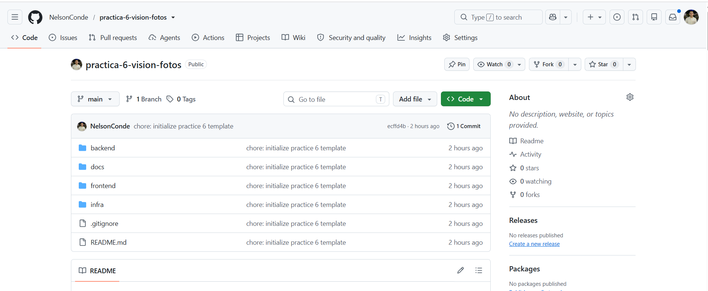
</p>

#### Proyecto activo en Google Cloud

<p align="center">
  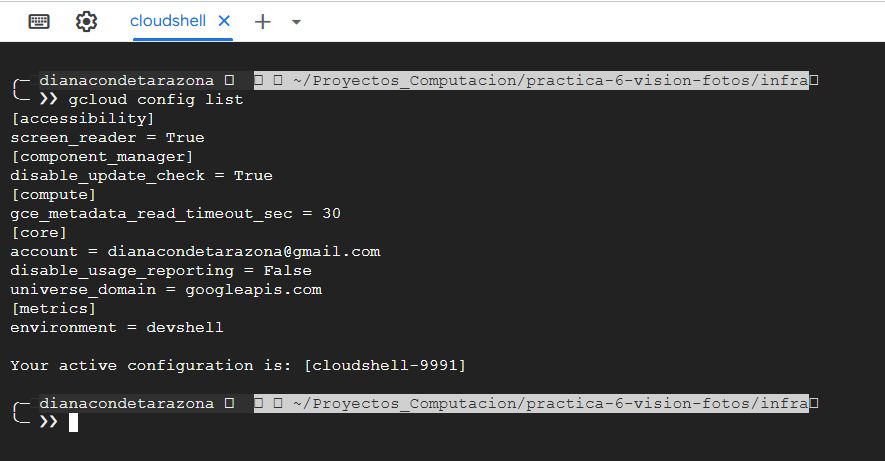
</p>

### Fase 1 — Primer despliegue

Se inicializó la infraestructura con Terraform y se creó el repositorio de Artifact Registry `nelson-imagenes`. Luego se construyeron y publicaron las imágenes `backend:v1` y `frontend:v1`.

Con las imágenes disponibles en Artifact Registry, se desplegaron los servicios `nelson-backend` y `nelson-frontend` en Cloud Run. En esta fase el bucket de Cloud Storage todavía no existe, por lo que el comportamiento esperado es que el frontend cargue correctamente y el backend responda que no tiene un bucket configurado.

#### Imágenes publicadas en Artifact Registry

Se verificó que las imágenes del backend y frontend estuvieran disponibles en Artifact Registry con la etiqueta `v1`.

<p align="center">
  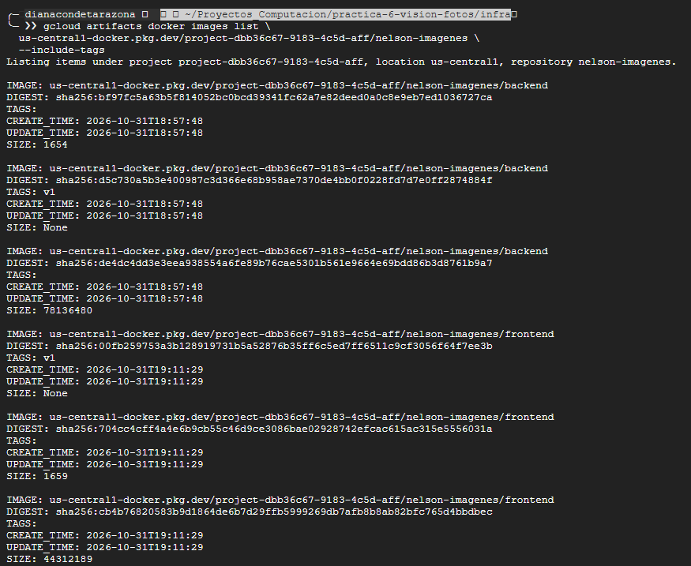
</p>

#### Frontend desplegado sin bucket configurado

Se accedió al frontend desplegado en Cloud Run y se comprobó que la aplicación informa que el backend todavía no tiene un bucket configurado, comportamiento esperado para esta fase.

<p align="center">
  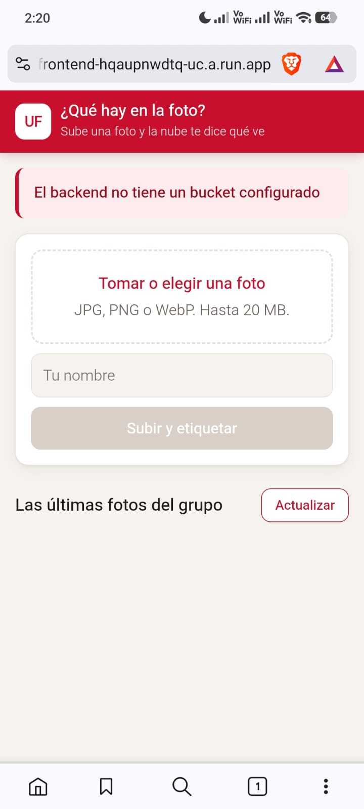
</p>

#### Advertencia en los registros del backend

Se consultaron los registros del servicio `nelson-backend` y se verificó la advertencia `BUCKET está vacía: no hay dónde guardar las fotos`, confirmando que el servicio está funcionando pero aún no dispone de almacenamiento persistente.

<p align="center">
  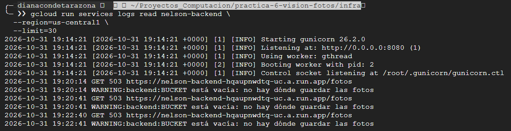
</p>

### Fase 2 — Bucket y permiso del backend

Se creó un bucket privado en Cloud Storage para almacenar las fotografías de la aplicación. El backend utiliza su cuenta de servicio para acceder al bucket mediante el rol `roles/storage.objectUser`, mientras que el acceso público al bucket permanece bloqueado.

Al subir una fotografía, el backend guarda dos objetos: la imagen original en el prefijo `originales/` y una miniatura en `miniaturas/`. En esta fase Cloud Vision todavía no está habilitado, por lo que la fotografía se guarda correctamente y aparece en la galería, pero sin etiquetas.

#### Bucket con los objetos almacenados

Se verificó en Cloud Storage que el bucket `project-dbb36c67-9183-4c5d-aff-nelson-fotos` contiene los prefijos `originales/` y `miniaturas/`, correspondientes a la fotografía original y su miniatura.

<p align="center">
  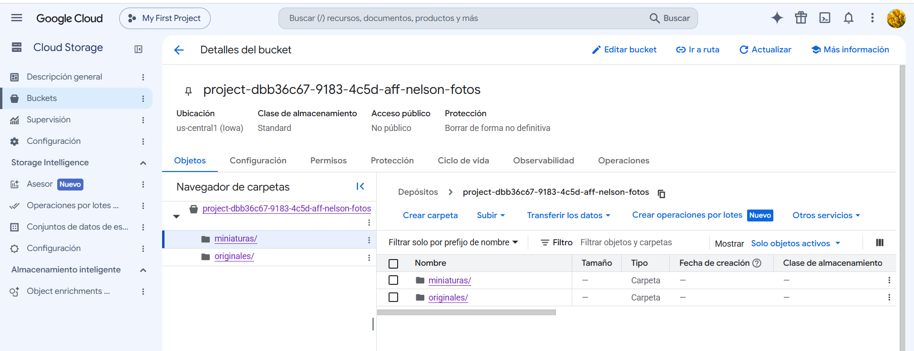
</p>

#### Galería con la fotografía sin etiquetas

Se comprobó desde la aplicación desplegada que la fotografía se almacena y aparece correctamente en la galería. Como Cloud Vision todavía no está habilitado en esta fase, la imagen aparece sin etiquetas.

<p align="center">
  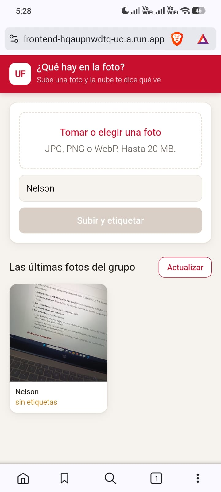
</p>

#### Advertencia de Cloud Vision en el backend

Los registros del servicio `nelson-backend` muestran la advertencia `Vision no respondió: 403`, indicando que la API de Cloud Vision todavía no está habilitada. Este comportamiento es el esperado para la Fase 2.

<p align="center">
  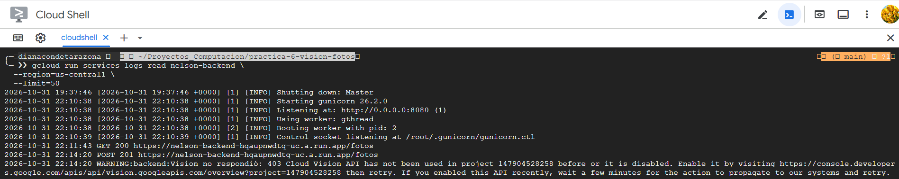
</p>

### Fase 3 — Vision habilitada

Se habilitó `vision.googleapis.com` mediante Terraform para que el backend pudiera utilizar Cloud Vision. Después de aplicar la infraestructura, se subió una nueva fotografía y el servicio obtuvo correctamente las etiquetas detectadas junto con su nivel de confianza.

La fotografía utilizada en esta fase fue procesada correctamente y recibió ocho etiquetas. La imagen subida en la Fase 2 permanece sin etiquetas porque el backend consulta Vision únicamente en el momento de la carga.

#### Fotografía con etiquetas de Vision

La nueva fotografía fue procesada por Cloud Vision y la aplicación mostró las etiquetas detectadas con sus porcentajes de confianza.

<p align="center">
  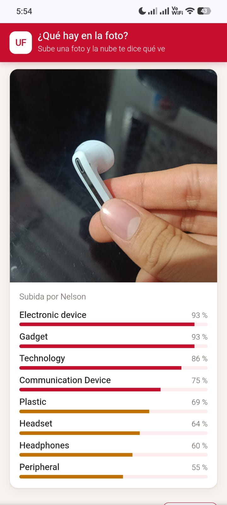
</p>

#### Registro del backend

Los registros del servicio `nelson-backend` confirman que la fotografía fue almacenada correctamente y que se obtuvieron ocho etiquetas.

<p align="center">
  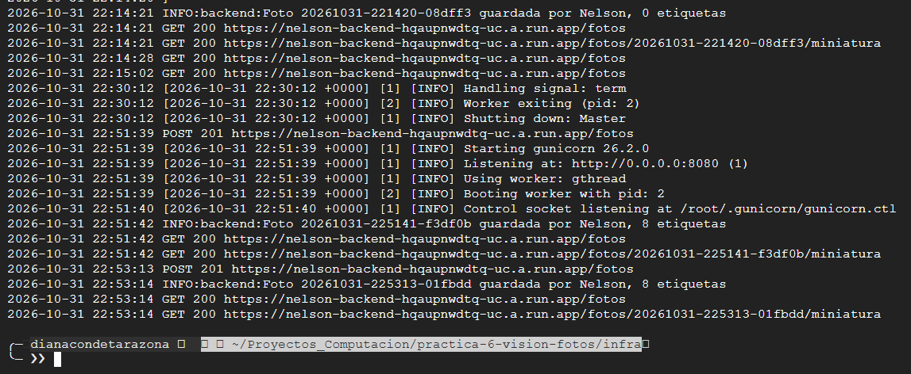
</p>

#### Cloud Vision API habilitada

Se verificó en Google Cloud Console que Cloud Vision API se encuentra habilitada y registrando solicitudes.

<p align="center">
  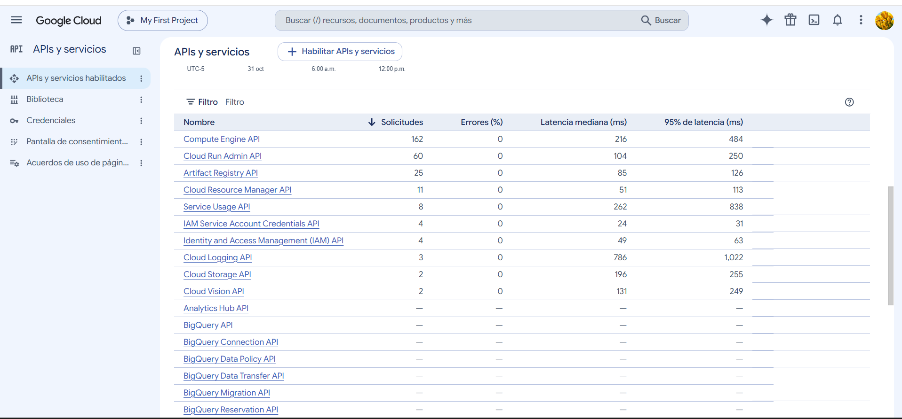
</p>

### Fase 4 — Pruebas de reconocimiento

Se probaron cinco tipos de fotografías para observar el comportamiento de Cloud Vision ante diferentes condiciones. Para cada imagen se registraron las primeras etiquetas devueltas, su nivel de confianza y una observación sobre el resultado.

| Prueba | Fotografía | Etiqueta 1 | Etiqueta 2 | Etiqueta 3 | Comentario |
| --- | --- | --- | --- | --- | --- |
| 1. Objeto común bien iluminado | Mano | Finger — 98 % | Hand — 98 % | Wrist — 92 % | El modelo identificó correctamente la mano y elementos asociados con una confianza alta. |
| 2. Elemento típico de la región | Comida típica | Food — 99 % | Ingredient — 95 % | Recipe — 84 % | Reconoció correctamente que se trataba de comida, aunque no identificó el plato específico. |
| 3. Dibujo o logo hecho a mano | Dibujo | Sketch — 58 % | — | — | Reconoció que era un dibujo, pero no logró identificar con suficiente precisión lo representado. |
| 4. Imagen con texto | Pantalla con documento | Text — 96 % | Electronic device — 93 % | Font — 91 % | Detectó correctamente la presencia de texto y que estaba mostrado en un dispositivo electrónico, aunque en esta fase no lee su contenido. |
| 5. Mismo objeto a contraluz | Mano a contraluz | Finger — 98 % | Hand — 98 % | Nail — 92 % | A pesar del contraluz, el modelo siguió reconociendo correctamente la mano con niveles altos de confianza. |

#### Galería de las pruebas

La galería muestra las cinco fotografías utilizadas para comparar el comportamiento de Cloud Vision en condiciones y contenidos diferentes.

<p align="center">
  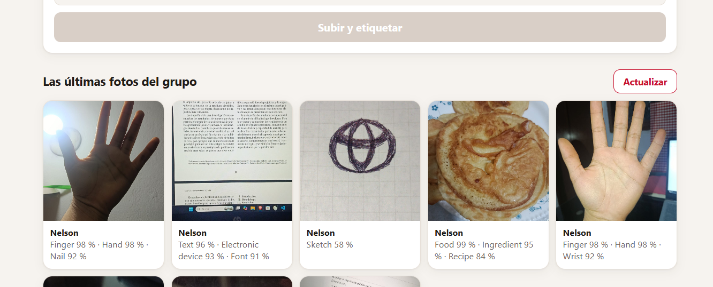
</p>

### Fase 5 — El bucket por dentro

Se inspeccionó el contenido del bucket para verificar cómo se almacenan las fotografías y sus miniaturas. También se revisaron los metadatos asociados a una miniatura y se comparó su tamaño con el archivo original correspondiente.

#### Metadatos de una miniatura

Se consultaron los metadatos del objeto `miniaturas/20261031-234955-57317a.jpg`. La salida confirma que el backend guardó información adicional como el autor, las etiquetas obtenidas por Cloud Vision y el estado de procesamiento.

<p align="center">
  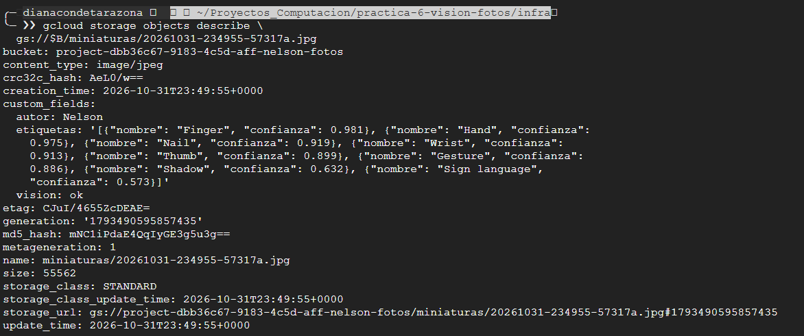
</p>

#### Comparación de tamaños

Se comparó el tamaño de una fotografía original con su miniatura correspondiente.

- Original: `2,051,760 bytes`
- Miniatura: `55,562 bytes`

La miniatura ocupa aproximadamente 37 veces menos espacio que la imagen original, lo que permite reducir significativamente la cantidad de datos transferidos cuando la galería muestra las fotografías.

<p align="center">
  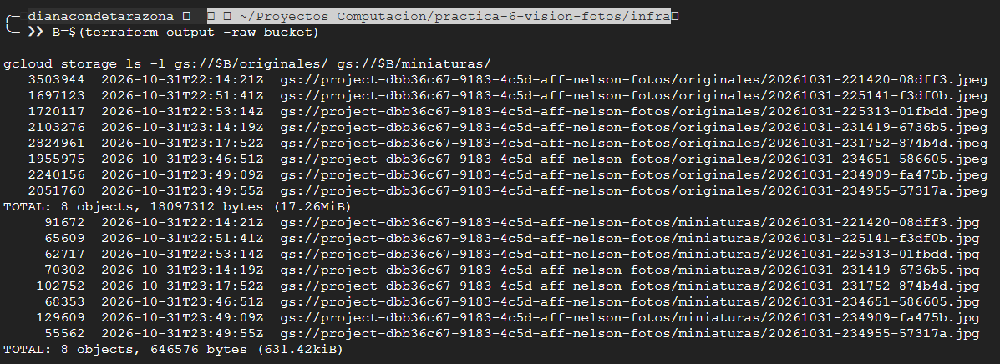
</p>

## Decisiones del reto

<!-- Qué cambiaste, por qué y cómo comprobaste que funciona. -->

## Preguntas

<!-- Las respuestas a las preguntas de la guía. -->
